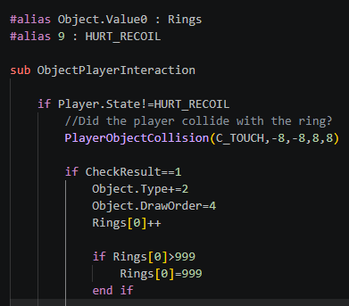
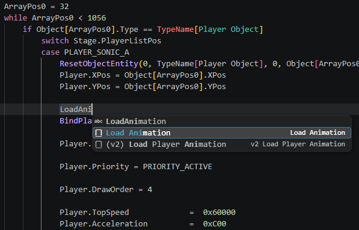
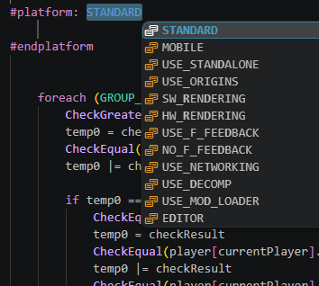

# RetroScript Extension for Visual Studio Code

An extension for Visual Studio Code which provides various features such as syntax highlighting, auto completion, etc. This extension can be used with various decomp versions, such as [RSDKv2 (Sonic Nexus)](https://github.com/RSDKModding/RSDKv2-Decompilation),  [RSDKv3 (Sonic CD)](https://github.com/RSDKModding/RSDKv3-Script-Decompilation) and [RSDKv4 (Sonic 1/Sonic 2/Sonic CD (2018))](https://github.com/RSDKModding/RSDKv4-Script-Decompilation).

## Features

- Syntax highlighting (seen in previews below).
- Auto completion for functions, alias groups, etc.
- Support for most decomp versions that support RetroScript.
- Support for platform preprocessors (i.e, `MOBILE`, `HW_RENDERING`, `USE_ORIGINS`).

<div align="left">
    
    
    
</div>

## Known Issues

Wrapping certain code around preprocessor definitions (i.e. if statements) will return a false error after it is completed. Example taken from Sonic 2's `Global/Monitor.txt` script:

```c
#platform: USE_ORIGINS
	if game.coinMode == false
		if stage.playerListPos == PLAYER_AMY
			SpriteFrame(-8, -9, 16, 14, 166, 118) // 5 - MONITOR_1UP_SONIC, except it's actually Amy
		else
			SpriteFrame(-8, -9, 16, 14, 51, 46) // 5 - MONITOR_1UP_SONIC, actually Sonic this time
		end if
#endplatform // <- Error occurs here, due to the "unfinished" if statement above
#platform: USE_STANDALONE
		SpriteFrame(-8, -9, 16, 14, 51, 46) // 5 - MONITOR_1UP_SONIC
#endplatform
		SpriteFrame(-8, -9, 16, 14, 68, 46) // 6 - MONITOR_1UP_TAILS
		SpriteFrame(-8, -9, 16, 14, 51, 61) // 7 - MONITOR_1UP_KNUX
#platform: USE_ORIGINS
	else // <- Error occurs here, as the highlighting *expects* there to be an if statement above
		SpriteFrame(-8, -9, 16, 14, 35, 100) // 5 - MONITOR_1UP_SONIC (Coin)
		SpriteFrame(-8, -9, 16, 14, 35, 100) // 6 - MONITOR_1UP_TAILS (Coin.. again)
		SpriteFrame(-8, -9, 16, 14, 35, 100) // 7 - MONITOR_1UP_KNUX (Coin :D)
	end if
#endplatform
```

## Release Notes

Please refer to the [changelog page](CHANGELOG.md) to know about the most recent release notes.
